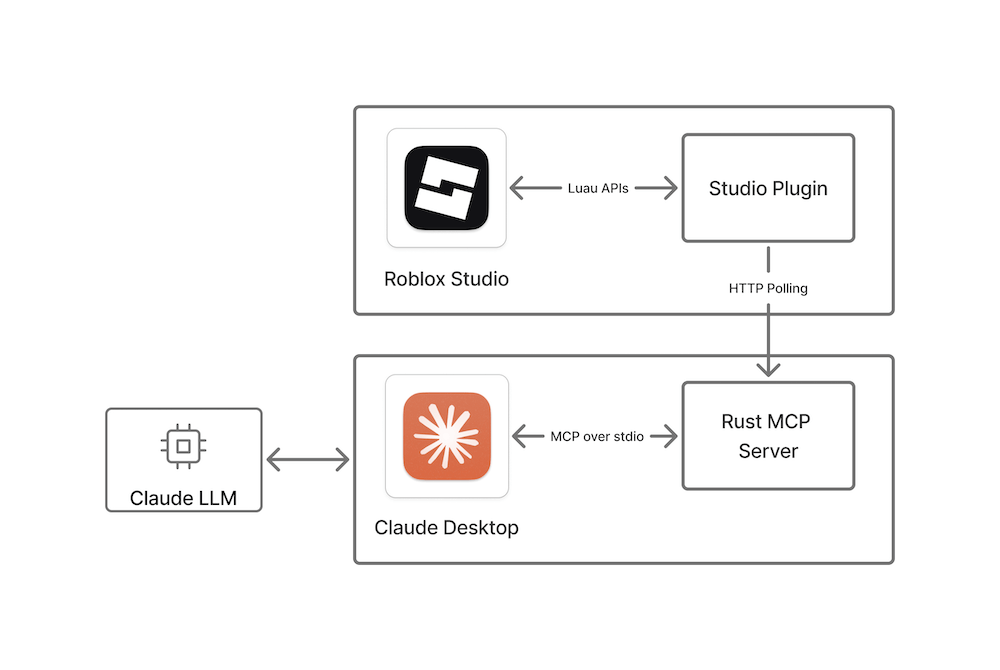

# Roblox Studio MCP Server (Custom Fork)

A custom fork of the [Roblox Studio MCP Server](https://github.com/Roblox/studio-rust-mcp-server) with additional tools for faster reads, batch operations, selection/navigation, DataStore inspection, asset management, and Rojo integration.

# Quick Setup
1. Build from source: `cargo run` (installs plugin + configures MCP clients)
2. Or use upstream binaries: [Windows](https://github.com/Roblox/studio-rust-mcp-server/releases/latest/download/rbx-studio-mcp.exe) | [macOS](https://github.com/Roblox/studio-rust-mcp-server/releases/latest/download/macOS-rbx-studio-mcp.zip)
3. Restart AI Client (Claude, Cursor, etc) and Roblox Studio
4. Done!

# Roblox Studio MCP Server

This repository contains a reference implementation of the Model Context Protocol (MCP) that enables
communication between Roblox Studio via a plugin and [Claude Desktop](https://claude.ai/download) or [Cursor](https://www.cursor.com/).
It consists of the following Rust-based components, which communicate through internal shared
objects.

- A web server built on `axum` that a Studio plugin long polls.
- A `rmcp` server that talks to Claude via `stdio` transport.

When LLM requests to run a tool, the plugin will get a request through the long polling and post a
response. It will cause responses to be sent to the Claude app.

**Please note** that this MCP server will be accessed by third-party tools, allowing them to modify
and read the contents of your opened place. Third-party data handling and privacy practices are
subject to their respective terms and conditions.



The setup process also contains a small plugin installation and Claude Desktop configuration script.

### Included tools

**Core (upstream):**
- **run_code** - Runs a command in Roblox Studio and returns the printed output. Can be used to both make changes and retrieve information.
- **insert_model** - Inserts a model from the Roblox Creator Store into the workspace. Returns the inserted model name.
- **get_console_output** - Gets the console output from Roblox Studio.
- **start_stop_play** - Starts or stops play mode or runs the server.
- **run_script_in_play_mode** - Runs a script in play mode and automatically stops play after the script finishes or times out. Returns structured output including logs, errors, and duration.
- **get_studio_mode** - Gets the current Studio mode (`start_play`, `run_server`, or `stop`).

**Custom fork additions:**
- **get_instance_tree** - Get instance hierarchy as structured JSON (faster than run_code + print parsing). Optional rootPath, maxDepth (default 3, max 5). Limited to 500 nodes / 100KB to prevent chat freezes.
- **get_properties** - Read instance properties directly (Name, ClassName, Attributes, Tags, Position, etc.).
- **batch_apply** - Apply property changes to multiple instances. Select by tag, className, or path.
- **select_instances** - Select instances in the Explorer programmatically.
- **open_script** - Open a script in the Script Editor.
- **read_datastore** - Read DataStore entries (development storage).
- **mock_datastore** - Set DataStore values for test scenarios.
- **get_asset_ids** - Get rbxassetid from instances (images, sounds, decals, etc.). Limited to 200 assets when scanning full game.
- **rojo_sourcemap** - Run `rojo sourcemap` for file-to-instance mapping (requires Rojo).
- **rojo_build** - Run `rojo build` to validate/sync project (requires Rojo).

**OAuth / Open Cloud tools (require setup, see below):**
- **roblox_login** - One-time browser-based OAuth login. Stores tokens locally.
- **roblox_logout** - Clear locally stored tokens.
- **upload_asset** - Upload a local file (Decal/Audio/Model/Animation/Mesh/Video) to your Roblox account.
- **update_asset** - Replace the contents of an existing asset by ID.
- **get_asset_info** - Read asset metadata via the Open Cloud Assets API.
- **list_my_assets** - Page through your inventory items via the v2 inventory endpoint.

## OAuth setup (one-time)

The Open Cloud tools above require a Roblox OAuth 2.0 application. The MCP itself never sees the client secret embedded in source — it reads two environment variables at startup and stores OAuth tokens locally per-user.

1. Visit the [Creator Dashboard → Open Cloud → OAuth 2.0 Apps](https://create.roblox.com/dashboard/credentials) and create an app.
2. Add **`http://localhost:44756/callback`** as a Redirect URI (the port is fixed; Roblox does not honor wildcard ports for native apps).
3. Under Permissions, enable at minimum **`openid`**, **`profile`**, **`asset:read`**, **`asset:write`**, and **`user.inventory-item:read`** (for `list_my_assets`). You can enable more scopes if you plan to extend the MCP later.
4. Copy the **Client ID** and **Client Secret**.
5. Export them as environment variables in the same shell / launch profile that runs the MCP binary:
   ```sh
   export ROBLOX_OAUTH_CLIENT_ID=...
   export ROBLOX_OAUTH_CLIENT_SECRET=...
   ```
   On Windows (PowerShell):
   ```powershell
   setx ROBLOX_OAUTH_CLIENT_ID "..."
   setx ROBLOX_OAUTH_CLIENT_SECRET "..."
   ```
   For Claude Desktop and similar GUI clients, you'll need to launch them from a shell where these are set (macOS/Linux) or use `setx` (Windows) so they're inherited.
6. Restart the MCP server, then ask the MCP `roblox_login`. A browser tab opens; authorize; you're done.
7. Tokens are written to `~/.config/rbx-studio-mcp/oauth-tokens.json` (or the platform equivalent) with `0600` perms on Unix. Refresh happens automatically as long as the refresh token is valid.

To revoke: run `roblox_logout` (clears local tokens) and/or revoke the app from the Creator Dashboard.

## Setup

### Install with release binaries

This MCP Server supports pretty much any MCP Client but will automatically set up only [Claude Desktop](https://claude.ai/download) and [Cursor](https://www.cursor.com/) if found.

To set up automatically:

1. Ensure you have [Roblox Studio](https://create.roblox.com/docs/en-us/studio/setup),
   and [Claude Desktop](https://claude.ai/download)/[Cursor](https://www.cursor.com/) installed and started at least once.
1. Exit MCP Clients and Roblox Studio if they are running.
1. Download and run the installer:
   1. Go to the [releases](https://github.com/Roblox/studio-rust-mcp-server/releases) page and
      download the latest release for your platform.
   1. Unzip the downloaded file if necessary and run the installer.
   1. Restart Claude/Cursor and Roblox Studio if they are running.

### Setting up manually

To set up manually add following to your MCP Client config:

```json
{
  "mcpServers": {
    "Roblox_Studio": {
      "args": [
        "--stdio"
      ],
      "command": "Path-to-downloaded\\rbx-studio-mcp.exe"
    }
  }
}
```

On macOS the path would be something like `"/Applications/RobloxStudioMCP.app/Contents/MacOS/rbx-studio-mcp"` if you move the app to the Applications directory.

For Claude Desktop, go to Settings > Developer > Edit Config. This opens location of the  `claude_desktop_config.json`.

Some clients require user to setup the mcp server manually for each project.
For example, Claude Code command would look like this:
```sh
claude mcp add --transport stdio Roblox_Studio -- '/Applications/RobloxStudioMCP.app/Contents/MacOS/rbx-studio-mcp' --stdio
```

### Build from source

To build and install the MCP reference implementation from this repository's source code:

1. Ensure you have [Roblox Studio](https://create.roblox.com/docs/en-us/studio/setup) and
   [Claude Desktop](https://claude.ai/download) installed and started at least once.
1. Exit Claude and Roblox Studio if they are running.
1. [Install](https://www.rust-lang.org/tools/install) Rust.
1. Download or clone this repository.
1. Run the following command from the root of this repository.
   ```sh
   cargo run
   ```
   This command carries out the following actions:
      - Builds the Rust MCP server app.
      - Sets up Claude to communicate with the MCP server.
      - Builds and installs the Studio plugin to communicate with the MCP server.

After the command completes, the Studio MCP Server is installed and ready for your prompts from
Claude Desktop.

## Verify setup

To make sure everything is set up correctly, follow these steps:

1. In Roblox Studio, click on the **Plugins** tab and verify that the MCP plugin appears. Clicking on
   the icon toggles the MCP communication with Claude Desktop on and off, which you can verify in
   the Roblox Studio console output.
1. In the console, verify that `The MCP Studio plugin is ready for prompts.` appears in the output.
   Clicking on the plugin's icon toggles MCP communication with Claude Desktop on and off,
   which you can also verify in the console output.
1. Verify that Claude Desktop is correctly configured by clicking on the hammer icon for MCP tools
   beneath the text field where you enter prompts. This should open a window with the list of
   available Roblox Studio tools (`insert_model` and `run_code`).

**Note**: You can fix common issues with setup by restarting Studio and Claude Desktop. Claude
sometimes is hidden in the system tray, so ensure you've exited it completely.

## Send requests

1. Open a place in Studio.
1. Type a prompt in Claude Desktop and accept any permissions to communicate with Studio.
1. Verify that the intended action is performed in Studio by checking the console, inspecting the
   data model in Explorer, or visually confirming the desired changes occurred in your place.
